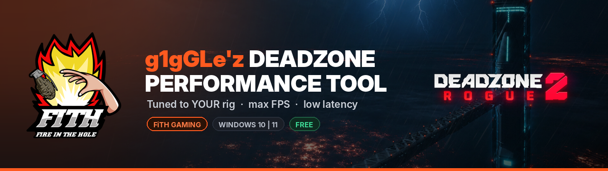
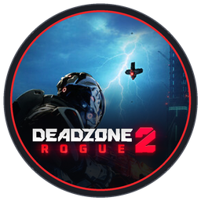
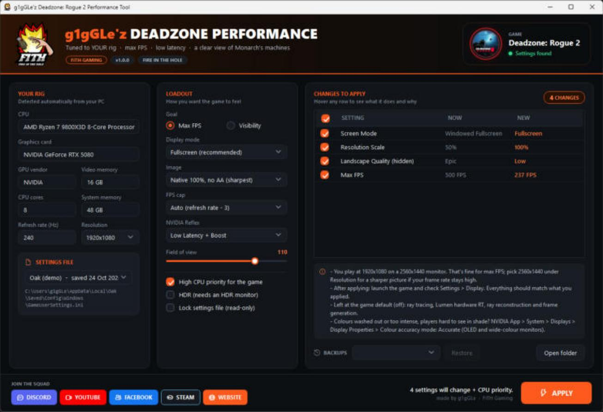

<div align="center">





### Max FPS. Low latency. A clear view of Monarch's machines. Tuned to *your* rig, not someone else's.

<a href="https://github.com/FiTH-g1gGLe/Deadzone-Rogue-2-Config-Tool/releases/latest/download/Deadzone-Rogue-2-Performance-Tool.zip"></a>
&nbsp;
<a href="https://discord.gg/Br7z7zBvFb"></a>

<a href="https://github.com/FiTH-g1gGLe/Deadzone-Rogue-2-Config-Tool/releases/latest"></a>


**[In action](#-in-action) · [Features](#-features) · [Quick start](#-quick-start) · [What it changes](#-what-it-changes) · [Pro tips](#-pro-tips-outside-the-game) · [FAQ](#-faq) · [Changelog](CHANGELOG.md)**

</div>

---

## 📸 In action

<div align="center">



<sub><b>See every change before it happens.</b> Tick what you want, hover any row to learn what it does and why it suits your rig.</sub>

</div>

---

## ⚡ Features

Most "best settings" guides tell you to put everything on Low and stop there. In Deadzone: Rogue 2 that still leaves
a hidden setting on **Epic**, and the game keeps each option in **two places** that have to agree.
**This tool reads your own settings file, detects your rig, and fixes only the values that matter.**

<table>
<tr>
<td width="33%" valign="top">

#### 🎯 Built for your rig
Your graphics card, video memory, monitor resolution and refresh rate decide the settings.

</td>
<td width="33%" valign="top">

#### 🔍 See every change
Each setting shows what it is now and what it becomes. Hover for what it does, how much it matters, and **why**.

</td>
<td width="33%" valign="top">

#### ☑️ You choose
Tick boxes on every change. Keep what you like, apply the rest.

</td>
</tr>
<tr>
<td valign="top">

#### 🕵️ Hidden settings
Landscape detail sits on Epic even with everything else on Low, and it isn't in the menu. The tool turns it down.

</td>
<td valign="top">

#### 🖼️ Sharp picture
Spots a low **Resolution Scale** (the game can end up drawing at half resolution) and puts you back at native 100%.

</td>
<td valign="top">

#### ⚡ Low latency
NVIDIA Reflex + Boost, V-Sync off, and an FPS cap just under your refresh rate for smooth frame times.

</td>
</tr>
<tr>
<td valign="top">

#### 🛡️ One-click undo
Every apply makes a timestamped backup. Pick one and hit **Restore**.

</td>
<td valign="top">

#### ✅ Checked twice
Every value is checked against what the game allows, then read back after writing. If anything is off, your file is put back.

</td>
<td valign="top">

#### 🔄 Auto-updates
The tool checks for a new version when it opens. One click and it updates itself.

</td>
</tr>
</table>

---

## 🚀 Quick start

> [!IMPORTANT]
> Launch Deadzone: Rogue 2 **once** first, open **Settings** and press **Apply**, then close the game. That creates the settings file the tool tunes.

| Step | |
|:---:|---|
| **1** | **[Download the latest release](https://github.com/FiTH-g1gGLe/Deadzone-Rogue-2-Config-Tool/releases/latest/download/Deadzone-Rogue-2-Performance-Tool.zip)** and unzip it anywhere. |
| **2** | Close the game, then double-click **`Run Deadzone Config Tool.bat`**. |
| **3** | **YOUR RIG** fills in by itself. Pick your **LOADOUT** (goal, display mode, image, FPS cap, FOV). Hover anything for a recommendation. |
| **4** | Untick anything in **CHANGES TO APPLY** you'd rather keep, then hit **APPLY**. |
| **5** | Launch the game and check **Settings → Display**. Everything should match. |

---

## 🧩 What it changes

### Smart settings, from your hardware

| Your hardware | Controls | Rule |
|---|---|---|
| 🖥️ **Monitor** | Resolution | Keeps the resolution you play at; your monitor's modes are listed with **native** marked, plus a tip if you play below it |
| 🔁 **Refresh rate** | Max FPS | refresh − 3 to keep G-SYNC/FreeSync active (game maximum of 500 above 360 Hz) |
| 🎮 **GPU vendor** | Latency | NVIDIA **Reflex: Low Latency + Boost** |
| 💾 **Video memory** | Textures (Visibility goal) | 12 GB+ → High · 8–11 GB → Normal · under 8 GB → Low |

### Your loadout

| Option | Choices |
|---|---|
| **Goal** | **Max FPS** (everything Low, shadows Off) or **Visibility** (sharper textures for your VRAM, Normal view distance) |
| **Display mode** | Fullscreen (recommended) · Windowed Fullscreen |
| **Image** | Native 100%, no AA (sharpest) · Native 100% + TSR (smooth edges) · Keep mine |
| **FPS cap** | Auto (refresh − 3) · 500 (game maximum) · Custom |
| **NVIDIA Reflex** | Low Latency + Boost · Low Latency · Off |
| **Field of view** | 80–120, starts at your current FOV · 100–110 recommended on 16:9 |
| **Extras** | High CPU priority for the game · HDR · lock the settings file read-only |

<details>
<summary><b>📋 The fixed baseline (click to expand)</b></summary>

<br/>

| Area | What it does |
|---|---|
| **Display** | V-Sync off, dynamic resolution off |
| **Quality** | View distance, anti-aliasing, post processing, textures, visual FX, shading, global illumination (Lumen), reflections and foliage on Low; shadows Off |
| **Hidden** | Landscape quality Low (the menu leaves it on Epic) |
| **Effects** | Motion blur and film grain off |
| **Preset** | Global Quality set to match (Low, or Custom if you pick Visibility or TSR), so the menu shows the right thing |

Every quality setting is written to **both** places the game keeps it: its own menu list and Unreal Engine's scalability values.

</details>

<details>
<summary><b>🚫 Deliberately left alone</b></summary>

<br/>

- **Mouse sensitivity, keybinds and controller settings:** muscle memory is yours.
- **Brightness, colour correction and sharpness:** personal taste and monitor-dependent. Colour correction exists for colour-blind players.
- **Ray tracing, Lumen hardware RT, ray reconstruction and frame generation:** off by default, and they stay off. Frame generation adds input lag.
- **Audio and voice:** your volumes stay as they are.

</details>

---

## 🎯 Pro tips (outside the game)

<table>
<tr>
<td width="50%" valign="top">

#### 🎨 OLED or wide-colour monitor?
If colours look washed out or too intense and players are hard to see in shade:
**NVIDIA App → System → Displays → Display Properties → Colour accuracy mode: Accurate.**
On AMD or other monitors, use the monitor's **sRGB** mode.

</td>
<td width="50%" valign="top">

#### 🖥️ G-SYNC / FreeSync
Make sure it's enabled **for your monitor**, not just globally (NVIDIA App → System → Displays).
With V-Sync **On** in the driver and Reflex in game, the tool's FPS cap keeps frame times smooth and tear-free.

</td>
</tr>
<tr>
<td valign="top">

#### ⚙️ Driver settings
Shader cache **Unlimited**, power management **Prefer maximum performance**.
Leave the game's HDR and Windows HDR **both off** unless you calibrate HDR properly.

</td>
<td valign="top">

#### 🔁 Check your refresh rate
Windows sometimes runs high refresh monitors at 60 Hz. **Settings → Display → Advanced display → Choose a refresh rate.**
The tool warns you if it spots this.

</td>
</tr>
</table>

---

## 🛡️ Safe by design

- **Never replaces your file.** It patches values in place and keeps everything else (keybinds, sensitivity, audio) exactly as it was.
- **Backups every time** in `%LOCALAPPDATA%\DeadzoneConfigTool\backups`, restorable from the window.
- **Read back after writing.** If a value didn't land, your original file goes straight back.
- **Won't write while the game is running.**
- **Admin only when needed:** High CPU priority is the only thing that asks, and you can untick it.

---

## ❓ FAQ

<details>
<summary><b>Where are the settings kept?</b></summary>
<br/>The demo saves to <code>%LOCALAPPDATA%\Oak\Saved\Config\Windows\GameUserSettings.ini</code> ("Oak" is the game's internal name). The playtest used <code>%LOCALAPPDATA%\Valhalla\...</code>. The tool finds both and picks the one you saved most recently; you can switch under <b>SETTINGS FILE</b>.
</details>

<details>
<summary><b>It says it can't find the settings file.</b></summary>
<br/>Launch the game, open Settings, press Apply, close the game, then run the tool again.
</details>

<details>
<summary><b>Why is my FPS capped at 237 on a 240 Hz monitor?</b></summary>
<br/>A cap a few frames under your refresh rate keeps G-SYNC/FreeSync active and frame times even, which feels smoother than running uncapped. Pick <b>500 (game maximum)</b> under FPS cap if you prefer.
</details>

<details>
<summary><b>Edges look jaggy or foliage shimmers.</b></summary>
<br/>That's the trade-off of no anti-aliasing. Set <b>Image</b> to <b>Native 100% + TSR</b>: smooth edges at native resolution for a few FPS.
</details>

<details>
<summary><b>The game reset some of my settings.</b></summary>
<br/>Run the tool again, or tick <b>Lock settings file (read-only)</b>. While it's locked, keybind and sensitivity changes won't save either, because they live in the same file.
</details>

<details>
<summary><b>How do I undo everything?</b></summary>
<br/>Pick the oldest backup in the <b>Backups</b> list and hit <b>Restore</b>.
</details>

<details>
<summary><b>Will this get me banned?</b></summary>
<br/>It only edits the game's own settings file, the same one the in-game menu writes to. It doesn't touch game files, memory or anti-cheat. As with any tweak, use it at your own risk.
</details>

<details>
<summary><b>Command line</b></summary>

```powershell
# Apply the recommended settings with no window
powershell -ExecutionPolicy Bypass -File .\Deadzone-Config-Tool.ps1 -Silent

# Show what would change without writing anything
powershell -ExecutionPolicy Bypass -File .\Deadzone-Config-Tool.ps1 -Silent -DryRun

# Use a specific settings file
powershell -ExecutionPolicy Bypass -File .\Deadzone-Config-Tool.ps1 -ConfigPath "C:\path\to\GameUserSettings.ini"

# Skip the update check
powershell -ExecutionPolicy Bypass -File .\Deadzone-Config-Tool.ps1 -NoUpdateCheck
```

</details>

---

## 🔗 Join the squad

<div align="center">

<a href="https://discord.gg/Br7z7zBvFb"></a>
<a href="https://www.youtube.com/user/FiTHGAMINGOFFICIAL"></a>
<a href="https://www.facebook.com/FiTHGAMINGOFFICIAL/"></a>
<a href="https://steamcommunity.com/groups/FiTHOFFICIAL"></a>
<a href="http://fithgaming.co.uk/"></a>

**Be part of something ep1c.**

Found a bug or got an idea? **[Open an issue](https://github.com/FiTH-g1gGLe/Deadzone-Rogue-2-Config-Tool/issues/new/choose)** or shout in the Discord.

</div>

---

<div align="center">
<br/>
<sub>Made by <b>g1gGLe</b> · <b>FiTH Gaming</b> · Fire in the Hole 🔥</sub>
<br/>
<sub>Unofficial fan-made tool. Not affiliated with or endorsed by Prophecy Games. Deadzone: Rogue is a trademark of its respective owner.</sub>
</div>
